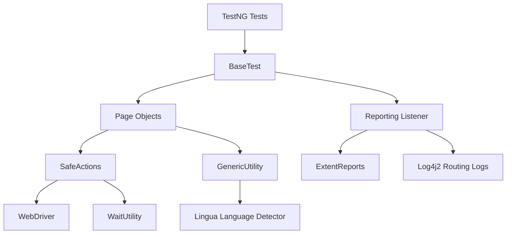
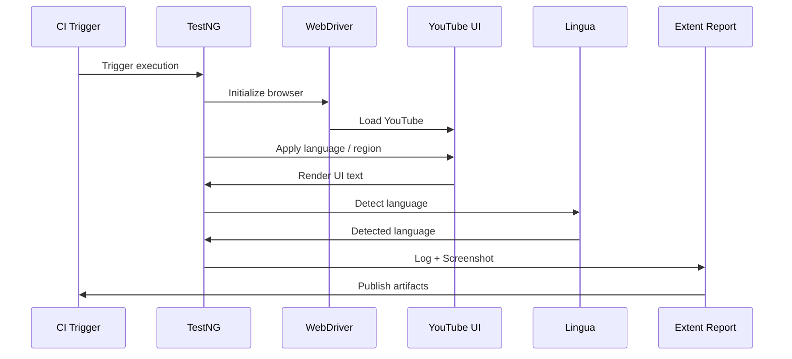
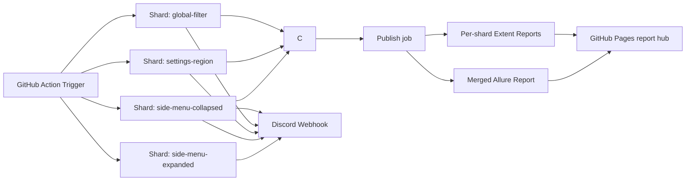

# 🎥 YouTube Multi-Language UI Validator Automation

A **production-grade end-to-end UI automation framework** engineered to **validate YouTube’s multi-language behavior across UI surfaces, menus, filters, and regional settings**.

This project is intentionally designed to behave like a **software system**, not a loose collection of Selenium scripts.  
It validates **language correctness, localization integrity, and regional behavior** using **real browser sessions**, **real UI text**, and **language detection intelligence**.

Every interaction is **safely executed**, **fully logged**, **screenshot-captured**, and **reported**, with **CI intelligence and public report hosting** built in.

---

## 📌 What This Project Validates

This framework performs **real-world validation** of YouTube’s UI across multiple languages and regions:

- Side menu language correctness (expanded & collapsed)
- Settings menu localization
- Global filter localization on search results
- `<html lang>` attribute correctness
- Region → country code mapping on YouTube logo
- Language correctness via **automatic language detection**
- UI stability across screen sizes and layouts

All validations are **data-driven**, **configuration-controlled**, and **CI-aware**.

---

## 🧠 Why This Project Stands Out

This project demonstrates:

- How to design **UI automation as a maintainable system**
- How to test **highly dynamic, real-world SPAs**
- How to build **deep observability** into automation
- How to validate **language correctness beyond string matching**
- How to integrate **CI, reporting, and notifications cleanly**

---

## 📑 Table of Contents

- Technology Stack
- Key Highlights (including Failure-Tolerant Loops / LoopGuard)
- Architecture
- Architecture Diagrams
- Execution Flow
- Language Intelligence (Lingua)
- Test Grouping
- CI & Reporting Intelligence
- Discord Notifications
- Folder Structure
- Running Tests
- Engineering Decisions Explained
- Extending the Framework
- Troubleshooting
- Disclaimers
- License

---

## 🧰 Technology Stack

### Core Language & Build
- **Java 21** (compiled with `release 21`; CI runs on JDK 24)
- **Maven**

### Browser Automation
- **Selenium 4.27**
- **WebDriverManager**
- Chrome, Firefox, Edge
- Configurable headless, GPU, sandbox, extensions

### Test Execution Engine
- **TestNG 7.10**
  - Parallel execution
  - Retry analyzers
  - Custom listeners
  - Suite-based execution
  - Test groups (feature groups used as CI shards, plus `lingua` / `non-lingua`)

### Data & Configuration
- **Apache POI** (Excel-driven tests)
- Centralized `masterdata.properties`
- Environment variable overrides
- CI-trigger-aware configuration

### Stability & Reliability Layer
- **SafeActions (custom abstraction)**:
  - Intelligent retries
  - JS click fallback
  - Page refresh recovery
  - Centralized waits
  - Structured logging
- **LoopGuard (per-language retry with retain)**:
  - Page recovery after a failed language
  - One retry of the same language, in code
  - Earlier checks kept, later languages still validated
  - Abort limits for environment vs element/code failures

### Language Intelligence
- **Lingua Language Detector**
  - Detects real language from UI text
  - Validates localization correctness
  - Prevents partial-translation false positives

### Logging & Diagnostics
- **Log4j2 Routing Appender**
  - Per-test logs
  - Per-run folders
  - Thread-safe logging

### Reporting
- **ExtentReports (Spark HTML)**
  - Embedded screenshots
  - Linked logs
  - Failure stack traces
  - Public hosting compatible
- **Allure Report**
  - Results collected per shard
  - Merged into one combined dashboard in CI

### CI/CD & DevOps
- **GitHub Actions**
  - Push
  - Pull Request
  - Manual dispatch
  - Nightly CRON
  - Four parallel shards (`side-menu-expanded`, `side-menu-collapsed`, `settings-region`, `global-filter`) + a single `publish` job
- Artifact storage (the Extent upload runs even after earlier step failures and errors if the run folder is empty)
- GitHub Pages hosting (report hub); the `gh-pages` push is retried up to 3 times

### Notifications
- **Discord Webhooks**
  - Start & completion alerts
  - Publish-result alert from the `publish` job (status + test job result), so a missing nightly message means the run or publish never happened
  - Status indicators
  - Direct links to reports

---

## ✨ Key Highlights

### 🧾 Fully Isolated Per-Run Artifacts

Each execution produces one clean, timestamped run folder:

```
run_<timestamp>/
  reports/ExtentReport.html
  logs/<testName>/<testName>.log
  screenshots/<testName>/<step>.png
```

Allure raw results are written separately to `target/allure-results/`.

No log mixing. No ambiguity.

---

### ⚙️ Configuration-Driven Execution

Execution depth is centrally controlled:

- Fast runs for pushes
- Deep coverage for nightly CRON
- No code changes required

---

### 🧠 CI-Aware Decision Making

The framework adapts based on trigger source:

| Trigger Type | Behavior |
|-------------|---------|
| Push / PR | Reduced language coverage |
| Nightly CRON | Full language & region validation |
| Manual | Developer-controlled |

---

### 🛡 Failure-Tolerant Loops (Retry With Retain)

Every test walks through up to 54 languages (or locations) on a live site that can hiccup at any point.
A plain `try/catch` around the whole loop means one exception on language 21 throws away languages 22 to 54.

`LoopGuard` fixes that with a **retry-with-retain** flow, one language at a time:

```
language fails (exception)
   -> recover the page (reload, reopen the dropdown)
   -> retry the SAME language once
        passes  -> logged, carry on
        fails   -> recorded as one clear failure, move to the NEXT language
   -> everything checked so far is retained (soft assertions)
```

- **Retain:** every check already made is kept, and every language after a failure is still validated.
  A bad language costs one language, not the rest of the run.
- **Retry, once, in code:** the retry is for that one language only, so the log shows exactly one retry in one
  place. It is separate from the TestNG test-level retry, which would rerun the whole test and make traces hard
  to follow.
- **Retries never hide mismatches:** a text mismatch is a soft-assert result, not an exception, so it is never
  retried. Only exceptions (timing, element, driver) get a second chance.
- **Fails fast when the run is clearly broken:** the loop aborts after 3 environment failures in a row
  (lost browser session, network error, render time-out) or 5 element/code failures in a row. A passing language
  resets the counts, so one-off glitches never trigger an abort.
- **Readable results:** failures read `Failed at Dansk (also failed on retry) | TimeoutException: ...`, and an
  abort reads `Aborted at ... remaining items not checked`. The report separates real page differences, items
  that could not be checked (and why), and items never reached.

Why it matters: on an uncontrolled live site, flakiness is normal. This keeps a nightly run useful by validating
everything that can be validated, even when something fails, and by saying clearly what could not be.
See `docs/project-challenges-live-site-automation.md` for the reasoning and trade-offs.

---

### 🌍 Language Detection (Beyond Text Matching)

UI text is validated using **actual language detection**, not assumptions.

This catches:
- Mixed-language UIs
- Partial translations
- Incorrect `<html lang>` attributes

---

### 🌐 Public GitHub Pages Reports

The latest execution report is always browser-accessible through a report hub page:
- Merged Allure dashboard (all shards)
- Separate Extent report per shard (one per feature group)
- No downloads
- Shareable links
- Embedded screenshots and logs

---

## 🏗 Architecture

### High-Level Architecture

```
Tests (TestNG)
  |
BaseTest
  |
Page Objects (YouTube UI)
  |
SafeActions (Resilience Layer)
  |
Driver + Utilities
  |
Lingua (Language Detection)
  |
Logging & Reporting
```

---

## 📐 Architecture Diagrams

### 1️⃣ System Layered Architecture



### 2️⃣ Execution & Observability Flow



### 3️⃣ CI & Notification Architecture



---

## 🔁 Execution Flow

```
CI Trigger (Push / CRON / Manual)
        |
Load configuration
        |
Initialize WebDriver
        |
Open YouTube
        |
Iterate languages / regions
        |
Apply UI actions safely
        |
Extract UI text
        |
Detect language & attributes
        |
Validate expected data
        |
Capture screenshots
        |
Generate logs & report
        |
Publish artifacts
        |
Notify Discord
```

---

## 🧪 Language Intelligence (Lingua)

The framework uses Lingua to:

- Detect the actual language rendered in UI text
- Compare against expected language mappings
- Validate `<html lang>` attribute
- Detect localization regressions early

This approach is far stronger than string comparison.

---

## 🗂 Test Grouping

Every `@Test` in `YtMasterTests` carries a TestNG group, which is also how CI splits the suite into shards:

| Group | Tests |
|---|---|
| `side-menu-expanded` (CI shard) | `verifyingSideMenuLanguageAsInSettings`, `verifyingSideMenuLanguageAsInSettingsLingua` |
| `side-menu-collapsed` (CI shard) | `verifyingSideMenuCollapsedLangAsInSettings`, `verifyingSideMenuCollapsedLangAsInSettingsLingua` |
| `settings-region` (CI shard) | `verifyingSettingOptionsLang`, `verifyCountryCodeAsBasedOnRegion` |
| `global-filter` (CI shard) | `verifyingGlobalFilterLandingPage`, `verifyingGlobalFilterLandingPageLingua` |
| `lingua` | `verifyingSideMenuLanguageAsInSettingsLingua`, `verifyingSideMenuCollapsedLangAsInSettingsLingua`, `verifyingGlobalFilterLandingPageLingua` |
| `non-lingua` | the other five tests |

The `groups` Maven property (empty by default = run everything) is passed to surefire, so a group is selected with `-Dgroups=<group>`.

A new test needs a feature-group tag (one of the four shard groups), otherwise it will not run in any CI shard.

---

## 📦 Folder Structure

```bash
yt_multi_language_ui_validator/
│
├── pom.xml
└── src/
    ├── main/
    │   ├── java/yt_multi_lang_ui_validator/
    │   │   ├── base/            BaseTest, BasePage
    │   │   ├── driverManager/   DriverManager
    │   │   ├── config/          ConfigManager
    │   │   ├── pages/           YtLandingPage, YtInnerPage
    │   │   ├── safeActions/     SafeActions
    │   │   ├── utilities/       GenericUtility, WaitUtility, LoopGuard,
    │   │   │                    ScreenshotUtilUpdated, ImageCompressor
    │   │   ├── lingua/          LinguaHelper
    │   │   ├── reporting/       ReportManager, Attachers, TestListenerUpdated
    │   │   ├── logger/          LoggerUtility
    │   │   ├── pathManager/     PathManager
    │   │   ├── fileReader/      FileReader
    │   │   ├── fileWriter/      ExcelFileWriter
    │   │   └── seleniumGrid/    GlobalGridUtility
    │   ├── resources/
    │   │   ├── data/*.xlsx
    │   │   └── log4j2.xml
    │   └── test/java/
    │       ├── tests/           YtMasterTests
    │       ├── retry/           RetryFailedTest, RetryListener
    │       └── runners/         testng.xml, lingua.xml
    └── test/resources/
        └── masterdata.properties

.github/workflows/master.yml
```

---

## ▶️ Running Tests

### Quick Smoke Run

```bash
mvn clean test
```

### Reduced Language Coverage

```bash
mvn clean test -DrunForAllLanguages=false
```

### Full Language Regression

```bash
mvn clean test -DrunForAllLanguages=true
```

### Run a Single Group

```bash
mvn clean test -Dgroups=lingua
mvn clean test -Dgroups=non-lingua
mvn clean test -Dgroups=side-menu-expanded   # or side-menu-collapsed, settings-region, global-filter
```

Run these from the `yt_multi_language_ui_validator/` folder. CI runs the same two commands as parallel shards.

---

## 🧩 Engineering Decisions Explained

### SafeActions Abstraction

Centralizes all browser interactions to:

- Reduce flakiness
- Standardize retries
- Enable recovery via refresh
- Improve observability

### LoopGuard Instead Of Test-Level Retry

- Failures in the language loops end as soft-assert failures, which the TestNG retry listener deliberately
  does not retry (it is set not to retry assertion errors)
- A whole-test retry would repeat every language and double the logs; a per-language retry is cheap and easy to trace
- Environment failures stop the loop sooner (3) than element/code failures (5), because a broken browser or
  network fails every remaining language the same way

### TestNG Over JUnit

Chosen for:

- Parallel execution
- Retry analyzers
- Listener ecosystem
- Suite flexibility

### ExtentReports + Allure

- Extent: self-contained HTML, screenshot-first debugging, one report per shard
- Allure: results from all shards merged into a single dashboard
- Both hosted together on GitHub Pages

### Log4j2 Routing

- Per-test log isolation
- Clean debugging
- No cross-thread log pollution

### CI Mode Switching

- Fast feedback for developers
- Deep coverage for nightly runs
- Zero manual toggling

---

## ➕ Extending the Framework

- Add new UI checks in `GenericUtility`
- Extend Page Objects for new YouTube surfaces
- Add new language mappings via Excel
- Tune retries and waits centrally
- Enable new browsers via `DriverManager`

---

## 🛠 Troubleshooting

- CAPTCHA may appear on YouTube → retry usually resolves it
- Increase waits only when absolutely necessary
- Verify GitHub Pages deployment if report links fail: a green CI run only means the `gh-pages` push succeeded. GitHub then runs a separate "pages build and deployment" workflow (Actions tab), which can fail or lag on its own and leave the site stale
- Scheduled (CRON) runs can be delayed or skipped by GitHub, and are auto-disabled after 60 days without repo activity; the Discord publish-result message is the quickest way to notice a missed night
- Logs are always linked inside the Extent report

---

## 🏁 Final Note

This project reflects real-world automation engineering:

- Observable
- Configurable
- Resilient
- CI-native
- Debug-friendly

---

## ⚠️ Disclaimers

- **Not affiliated with YouTube or Google.** YouTube, Google, and related marks are trademarks of Google LLC. This is an independent project and is not endorsed, sponsored, or approved by Google.
- **Terms of Service.** This framework drives YouTube's public web UI through an automated browser. Automated access may conflict with [YouTube's Terms of Service](https://www.youtube.com/t/terms). You are solely responsible for ensuring your use complies with them and with applicable laws.
- **Educational and testing purposes only.** Intended for learning, demonstration, and QA research. Do not use it for scraping, bulk data collection, traffic generation, or any activity that disrupts the service.
- **Fragile by nature.** YouTube's DOM, locators, and UI text change frequently and without notice. Test failures may indicate a UI change, A/B experiment, or CAPTCHA rather than a localization defect.
- **No guarantee of language-detection accuracy.** Language detection (Lingua) is probabilistic. Short strings, brand names, and mixed-script text can produce false positives or negatives, so results should be reviewed by a human.
- **Region and account variability.** Content and UI can differ by IP location, account, cookies, consent dialogs, and experiments. Results may not be reproducible across machines or networks.
- **Use rate limits responsibly.** Running tests in parallel or at high frequency can trigger CAPTCHAs or temporary blocks. You are responsible for any resulting consequences.
- **Credentials and secrets.** Never commit Discord webhook URLs, tokens, or account credentials. Supply them via environment variables or CI secrets.
- **Public reports.** Reports, logs, and screenshots may be published to GitHub Pages. Ensure they contain no personal or sensitive information before publishing.
- **Third-party software.** This project depends on third-party libraries (Selenium, TestNG, Lingua, Apache POI, Allure, ExtentReports, Log4j, etc.), each governed by its own license.
- **No warranty.** Provided "as is" under the MIT License, without warranty of any kind. The author is not liable for any damages arising from its use.

---

## 📄 License

Released under the [MIT License](LICENSE). Copyright (c) 2026 Sagar Jhathi.

